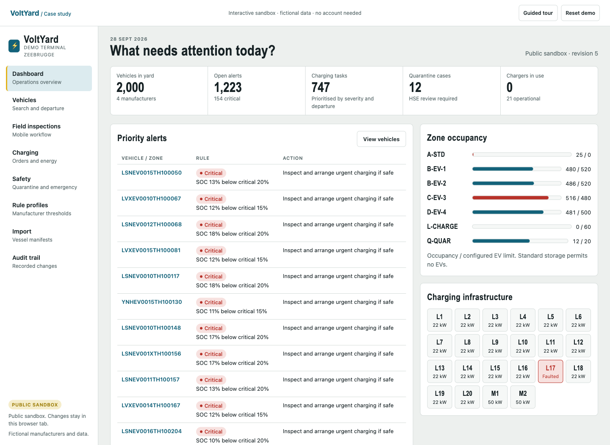

# VoltYard

**EV battery care, charging coordination and traceable yard operations for automotive terminals.**

VoltYard follows each vehicle by VIN, records battery inspections, evaluates configurable manufacturer profiles and brings charging and quarantine work into one operational view.

**Status:** working local development application with a C#/.NET 10 backend and an English web interface. The repository also contains a product, research, validation and architecture dossier. This is a single-terminal demonstration, not an approved terminal safety system.

## Public showcase

**[Explore VoltYard on GitHub Pages](https://phlppgdfry.github.io/VoltYard/)** · **[Open the interactive demo](https://phlppgdfry.github.io/VoltYard/demo/)** · **[Take the guided tour](https://phlppgdfry.github.io/VoltYard/demo/?tour=1)**

The public site is open to everyone without a login. It includes the portfolio case study and a browser-only sandbox with all 2,000 fictional vehicles, a six-step walkthrough, tab-local saved changes, reset, CSV import, charging, quarantine and printable handover records. It makes no backend requests. The .NET application below provides the separately runnable server implementation.



Build the static site with `python3 tools/build_pages.py`; verify it with `python3 tools/check_pages.py` and `node --test tests/public-sandbox.test.mjs` (Node 24 for sandbox tests). GitHub Actions publishes `_site/` to Pages on pushes to `main`. See [public showcase](docs/public-showcase.md).

## Run locally

Install the .NET 10 SDK and Python 3. No Node.js build step, database service or paid API is required.

```bash
git clone https://github.com/phlppgdfry/VoltYard.git
cd VoltYard
python3 tools/generate_demo_data.py
dotnet run --project src/VoltYard.Api --launch-profile local
```

Open **http://127.0.0.1:5080**. Development accounts: `admin`, `planner`, `operator`, `hse`, `account`. Password: `VoltYard-demo-2026`. All data and manufacturer profiles are fictional. Set `Demo__Password` to override the development password. These shared demonstration accounts are not a production identity system.

Changes survive refreshes and server restarts in `var/yard.json`. To start an independent demo, set `Data__Path` to a new file path before launching. Existing stores are never overwritten by the generator. Back up the store with the server stopped; keep the file outside version control.

```bash
dotnet test
python3 tools/check_repository.py
python3 tools/smoke_test.py  # with the application running on port 5080
```

The smoke test creates and changes fictional records. Run it against a disposable data store, as described in [testing](docs/testing.md).

## What works

| Area | Implemented behaviour |
|---|---|
| Access | Cookie sessions, five demo roles, server-side command permissions, login rate limiting |
| Dashboard | Prioritised alerts, vehicle counts, zone occupancy and charger availability |
| Vehicles | Search, manufacturer/zone/status filters, pagination, detail, history and SOC chart |
| Inspections | SOC and 12V observations, damage/concern reporting, outlier confirmation, append-only records |
| Rules | Manufacturer/model selection, boundary rules, stale-reading forecast, versioned threshold edits and simulation |
| Charging | Approve → start → stop; charger exclusivity; quarantine guards; actual end SOC; metered or estimated energy |
| Safety | Quarantine request, zone transfer, HSE decision with justification, emergency CSV |
| Departure | Destination/date planning and server-enforced readiness checks |
| Import | Quoted CSV parsing, VIN/check-digit validation, duplicate detection, per-row errors and capacity checks |
| Evidence | Handover snapshot, inspection/profile provenance, charging sessions, audit events and browser Print / Save as PDF |
| Storage | Atomic file replacement, transaction rollback on failure, optimistic concurrency |

The connected application loads all **2,000 vehicles**, **11,714 inspections**, **667 historical charging sessions**, seven profiles, seven zones and 22 chargers. [Fixtures](demo/README.md) are deterministic. The standalone [HTML prototype](prototype/index.html) uses 60 vehicles and simplified session-only commands.

## Repository map

```text
src/VoltYard.Domain/          Entities, VIN validation and pure rules
src/VoltYard.Application/     Commands, workflow guards and import handling
src/VoltYard.Infrastructure/  Transactional single-process JSON file store
src/VoltYard.Api/             ASP.NET Core host, authentication and HTTP endpoints
tests/VoltYard.Tests/         Domain, workflow and persistence regression tests
prototype/                   English UI template and standalone generated preview
demo/                        Deterministic fictional fixtures
showcase/                    Portfolio page, static assets and public sandbox adapter
tools/                       Data generation, verification, Pages build and GitHub board helper
docs/                        Research, product, delivery and assessment dossier
.github/workflows/           Automated repository checks, build and tests
```

## Review of operational fit

**[Operational readiness review](docs/09-review/operational-readiness.md)** · **[Proposed shadow-mode pilot](docs/04-validation/pilot-plan.md)**

The industry workflow is real, but demand for VoltYard is not yet validated. Current research identifies material overlap with existing terminal and charging systems. The review records corrected defects, remaining operational blockers, integration questions and a concrete discovery plan. This is a portfolio/discovery instrument, not a production acceptance claim.

## Read the dossier

| Topic | Start here |
|---|---|
| Problem and context | [Problem statement](docs/01-problem/problem-statement.md), [market context](docs/02-research/market-context.md) |
| Research evidence | [Sources](docs/02-research/sources.md), [competition](docs/02-research/competition.md), [standards and guidance](docs/02-research/standards-and-guidance.md) |
| Product | [Vision](docs/03-concept/vision.md), [personas](docs/03-concept/personas.md), [journeys](docs/03-concept/user-journeys.md), [scope](docs/03-concept/features.md) |
| Core logic | [Rule profiles](docs/03-concept/rule-profiles.md), [charging](docs/03-concept/charging.md), [test scenarios](demo/rule-engine-cases.md) |
| Validation | [Hypotheses](docs/04-validation/hypotheses.md), [interviews](docs/04-validation/interview-guide.md), [outreach](docs/04-validation/outreach.md) |
| Engineering | [Architecture](docs/05-architecture/architecture.md), [data model](docs/05-architecture/data-model.md), [API](docs/05-architecture/api-design.md), [security](docs/05-architecture/security-and-privacy.md), [ADRs](docs/05-architecture/adr/README.md) |
| Delivery | [Plan](docs/06-delivery/delivery-plan.md), [backlog](docs/06-delivery/backlog.md), [risks](docs/06-delivery/risks.md), [done criteria](docs/06-delivery/definition-of-done.md) |
| Demonstration | [Demo script](docs/07-assessment/demo-script.md), [assessment evidence](docs/07-assessment/assessment.md), [testing](docs/testing.md) |
| Commercial | [Business model](docs/08-business/business-model.md) |
| Supporting material | [Open questions](docs/open-questions.md), [decision log](docs/decision-log.md), [glossary](docs/glossary.md), [C# learning plan](docs/csharp-learning-plan.md), [operations](docs/operations.md) |

## Deliberate limits and next release

The current persistence adapter is an atomic JSON file owned by one process. PostgreSQL/EF Core, tenant isolation, individual user administration, OIDC/SSO, background alert lifecycle, SignalR, OCPP, photos, barcode scanning, offline sync, external integrations and automated cloud deployment remain on the roadmap. Browser printing produces the PDF; there is no server-side PDF engine.

The software records observations and workflow decisions. It does not detect thermal runaway, control physical chargers, certify battery health or replace site emergency procedures. Configure real OEM/carrier profiles only after approval by the responsible operators.

## Container option

```bash
export Demo__Password='choose-a-long-local-demo-password'
docker compose up --build
```

This compose setup is explicitly a local Development demo bound to loopback. See [operations](docs/operations.md) before any hosted deployment.
