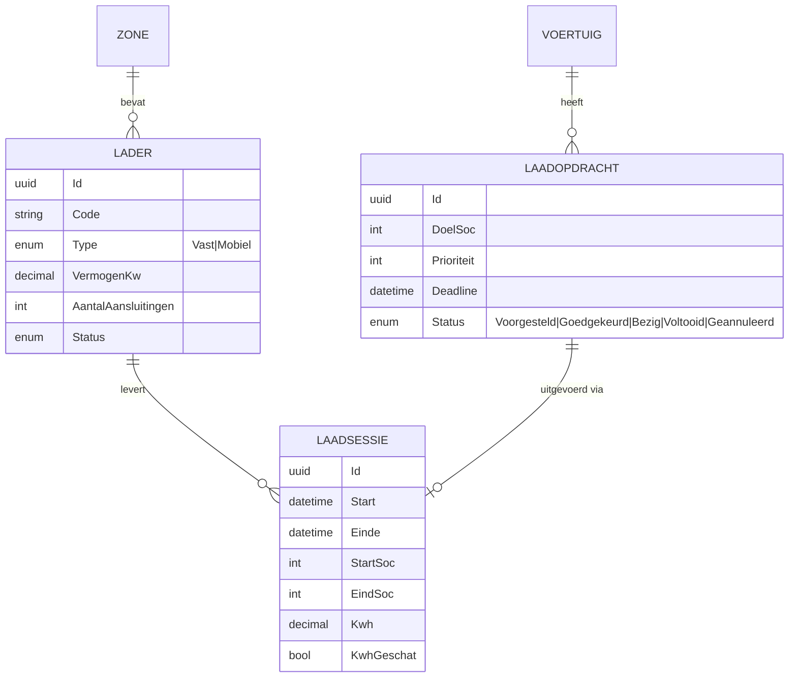

# Laadmodule

## Waarom een aparte module?

Het onderzoek toont aan dat terminals **al fysiek laden** (bv. WWL Zeebrugge: wandladers voor 20 EV's tegelijk, tot 22 kW, met een instelbare maximale laadtoestand) en dat laden deel uitmaakt van de "dwell economy": een **dienst die je aan de fabrikant kan factureren**.

Wat ontbreekt is de **coördinatie**:
- *welke* wagen *wanneer* aan *welke* lader, en tot *welke* laadtoestand?
- *hoeveel* kWh per fabrikant, en hoe factureer je dat?
- hoe vermijd je dat je een wagen te vol laadt voor verscheping?
- hoe vermijd je dure pieken in het stroomverbruik?

De laadmodule kan **apart ingeschakeld** worden. Een terminal kan VoltYard dus ook gebruiken zonder de laadmodule (alleen het logboek, de regels en de veiligheid). Dat maakt het ook een **betalende optie** in het [businessmodel](../08-business/businessmodel.md).

## Niveaus

### Niveau 1: handmatig (finalisatie, MUST/SHOULD)
- **Laders registreren:** code (L1..Ln), type (vast / mobiel), vermogen (kW), zone, aantal aansluitingen, status (beschikbaar / bezet / defect).
- **Laadopdrachten:** automatisch voorgesteld door de regelmotor (`SOC_ONDER_MIN`, `VERTREK_SOC_TE_LAAG`...), of handmatig aangemaakt.
  - Doellaadtoestand = min(`DoelOpslagSoc`, max. laadtoestand van de volgende bestemming, `MaxLaadSoc`)
  - Prioriteit = f(ernst, dagen tot vertrek, huidige laadtoestand)
- **Laadsessie:** starten (VIN + QR van de lader scannen) en stoppen (eind-laadtoestand invoeren, kWh van het display van de lader).
- **Schatting van de kWh** als de lader geen waarde geeft: `(eind-SOC − start-SOC) × batterijcapaciteit / laadrendement`.
- **Overzicht voor facturatie:** kWh, sessies en laadbeurten per fabrikant per periode, met CSV-export.

### Niveau 2: slimme planning (COULD)
- **Laadplanner:** gegeven N wagens die geladen moeten worden en M laders met capaciteit, maak een planning voor de komende 24 à 48 uur.
  - V1-algoritme: *greedy*, sorteren op deadline en prioriteit, dan het eerste vrije tijdslot op een geschikte lader.
- **Piekbeheer:** een maximaal totaal vermogen per locatie (bv. 200 kW). De planner verdeelt het laden over de tijd en vermijdt zo **piekkosten** op de energiefactuur.
- **Route voor de mobiele laadunit:** welke wagens de mobiele unit vandaag laadt, gegroepeerd per zone.

### Niveau 3: automatische koppeling (WON'T voor de finalisatie, wel roadmap)
- **OCPP-koppeling** (Open Charge Point Protocol, de open standaard tussen laders en beheersoftware):
  - automatisch sessies starten en stoppen;
  - meetwaarden (kWh, vermogen, en laadtoestand indien de lader en de wagen die doorgeven);
  - laadlimieten instellen per sessie (*charging profiles*).
- **Telematica van de fabrikant:** laadtoestand uitlezen zonder dat iemand naar de wagen hoeft (vereist toestemming en koppeling met de fabrikant).
- **Batterijpaspoort (vanaf februari 2027):** statische data zoals capaciteit, chemie en batterijgezondheid via de QR-code of een API.

## Datamodel (uitbreiding)

## Businesswaarde van de laadmodule

| Voor wie | Waarde |
|---|---|
| Terminal | Laden wordt **factureerbaar** (kWh + dienst per wagen), minder dode wagens, lagere piekkosten |
| Fabrikant | Wagens komen met de juiste laadtoestand bij de dealer, bewijs van correct laden |
| Rederij | Wagens voldoen aan de maximale laadtoestand bij verscheping |

## Open vragen
- [ ] Welke laders gebruiken de terminals in Zeebrugge? Ondersteunen die OCPP?
- [ ] Wordt laden vandaag al gefactureerd, en hoe (per wagen, per kWh, of inbegrepen)?
- [ ] Wie leest vandaag de laadtoestand af: een medewerker in de wagen, het display van de lader, of een app van de fabrikant?
