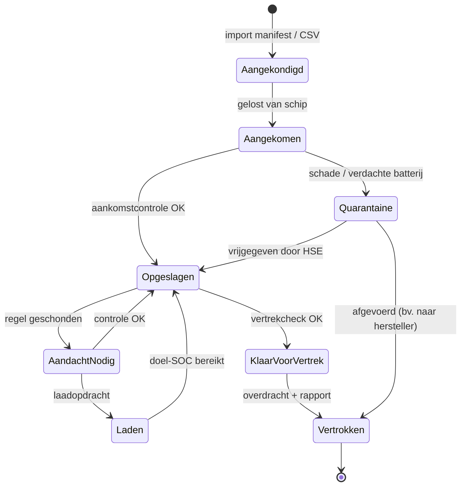

# User journeys

De levensloop van een EV op de terminal, en wat VoltYard bij elke stap doet.

---

## Journey 1: Een schip met 400 EV's komt aan

| Stap | Wie | Actie | VoltYard |
|---|---|---|---|
| 1 | Planner | Laadt de lijst van het schip op (CSV met VIN, merk, model, bestemming, geplande vertrekdatum) | Maakt 400 voertuigdossiers aan en koppelt ze automatisch aan een **regelprofiel** per merk en model |
| 2 | Terreinmedewerker | Rijdt de wagens naar de EV-zone | Waarschuwt als een zone boven de **maximale EV-dichtheid** gaat |
| 3 | Terreinmedewerker | **Aankomstcontrole:** VIN scannen, laadtoestand aflezen op het dashboard van de wagen, 12V OK?, visuele schade? | Registreert de meting. Bij schade of een verdachte batterij: **quarantaine vereist** |
| 4 | Systeem | Beoordeelt de regels | Wagens met een laadtoestand onder het minimum → waarschuwing **"Laden nodig"** met prioriteit |
| 5 | Planner | Bekijkt het dashboard | *"12 wagens moeten binnen 48 uur geladen worden. 3 wagens in quarantaine."* |

## Journey 2: Dagelijkse opvolging

| Stap | Wie | Actie | VoltYard |
|---|---|---|---|
| 1 | Systeem (elke nacht) | Beoordeelt alle wagens | Maakt waarschuwingen aan: **controle te laat** (interval verstreken), **voorspelde onderschrijding** (op basis van de ontlaadsnelheid) |
| 2 | Planner | Keurt de takenlijst voor vandaag goed | Genereert **controlerondes per zone**, gesorteerd voor een logische route |
| 3 | Terreinmedewerker | Werkt de takenlijst af op de gsm | Elke controle werkt de voorspelling en de waarschuwingen live bij (SignalR) |

## Journey 3: Laden (laadmodule)

| Stap | Wie | Actie | VoltYard |
|---|---|---|---|
| 1 | Systeem | Detecteert dat laden nodig is | Stelt een **laadopdracht** voor: doellaadtoestand (volgens het profiel en de volgende bestemming), prioriteit, beschikbare lader |
| 2 | Planner | Keurt goed of past aan | Houdt rekening met laadcapaciteit, piekvermogen en vertrekdata |
| 3 | Terreinmedewerker | Hangt de wagen aan lader L3 en scant de VIN plus de QR van de lader | Start de laadsessie |
| 4 | Terreinmedewerker / lader | Registreert het einde: laadtoestand en kWh | Sluit de sessie en noteert de kWh **per fabrikant** voor facturatie |

Zie de [laadmodule](laadmodule.md) voor de details.

## Journey 4: Quarantaine

| Stap | Wie | Actie | VoltYard |
|---|---|---|---|
| 1 | Terreinmedewerker | Meldt schade, geur, rook, warmte of een batterijwaarschuwing op het dashboard | Wagen krijgt de status **Quarantaine vereist**, HSE wordt meteen verwittigd |
| 2 | Terreinmedewerker | Verplaatst de wagen naar de quarantainezone en scant de zone | Status wordt **In quarantaine**, met de tijd en de verantwoordelijke |
| 3 | HSE | Beoordeelt: vrijgeven, naar hersteller, of wachten op de fabrikant | Een beslissing is **verplicht** met motivering, en de fabrikant krijgt bericht |

## Journey 5: Vertrek en overdracht

| Stap | Wie | Actie | VoltYard |
|---|---|---|---|
| 1 | Planner | Plant het vertrek (truck, trein of verscheping) | Controleert de **vertrekregels**: laadtoestand binnen de grenzen voor die bestemming? Geen open waarschuwingen? |
| 2 | Systeem | Wagen voldoet niet (bv. laadtoestand 70%, maximum 50% bij verscheping) | Waarschuwing **Niet klaar voor vertrek**, met de reden en een voorgestelde actie |
| 3 | Terreinmedewerker | Laatste controle bij vertrek | Status wordt **Vertrokken** |
| 4 | Systeem | Genereert het **overdrachtsrapport** (PDF) | Per VIN of per batch: de geschiedenis van de laadtoestand, controles, laadbeurten en incidenten, met tijdstempels |

## Journey 6: Maandafsluiting (account manager)

- Filter op fabrikant en maand → overzicht van het aantal controles, laadbeurten, kWh, quarantainedagen en gemiddelde wachttijd → export naar CSV voor facturatie.

## Journey 7: Noodsituatie (HSE)

- Brandmelding in zone C → HSE opent het **noodoverzicht van de zone** → lijst van alle EV's in zone C met laadtoestand, of ze kunnen rijden en hun plaats → export of afdruk voor de brandweer.
