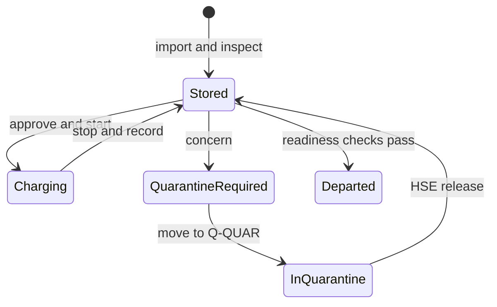

# User journeys

## 1. Arrival

Planner uploads a manifest → server validates each row → valid, unique VINs enter B-EV-1 while capacity permits → server selects the most specific profile → operator performs the first inspection.

An imported vehicle has no fabricated SOC measurement. Its detail shows **Not measured**, an inspection is overdue and the conservative rules prevent treating the vehicle as ready.

## 2. Routine inspection

Operator chooses a task or enters a VIN → reads observed SOC → records 12V state, damage and concerns → confirms an unusually low reading if prompted → server appends the inspection with actor and profile version → alerts are recalculated.

Old measurements cannot be edited through the API. A later observation adds a new record.

## 3. Charging

Low SOC or forecast prompts a task → planner approves → operator starts on an available charger → server reserves that charger → operator stops with actual end SOC and optional metered kWh → server releases the charger, appends a charging observation and records energy.

Quarantine blocks approval/start. A suspected issue cannot be cleared by entering a higher SOC. Charging completion does not count as a new manual 12V or damage inspection.

## 4. Safety concern

Operator records a concern → vehicle requires quarantine → staff follow the physical site procedure → recorded movement enters Q-QUAR → HSE chooses Released, Repair required or Awaiting manufacturer with a justification.

Only Released permits movement out of quarantine. Release moves the demo vehicle to B-EV-1 if capacity permits; if not, the whole decision command fails without partial changes.

## 5. Departure

Planner saves destination and date → departure limits apply inside the seven-day warning window → planner resolves vehicle alerts → confirms departure → server checks limits again even if the scheduled date lies outside the warning window → inventory counts exclude the departed vehicle.

The record remains accessible for handover and history. Departure exceptions are not implemented; this release blocks instead of silently overriding.

## 6. Handover

User opens a vehicle report → server returns a snapshot ID and generation time, measurement/profile provenance, energy sessions, quarantine case, current alerts and audit events → user prints or saves as PDF.

## State overview

Status labels are derived from observations, orders and unresolved concerns. They are not independent editable flags.
