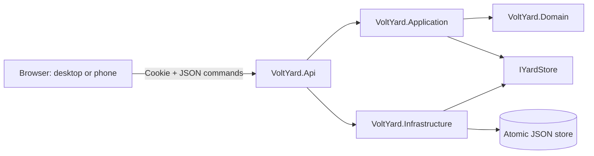
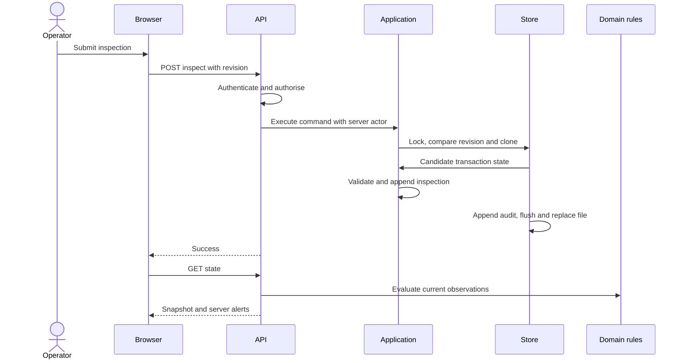

# Architecture

## Executable system

VoltYard is a modular monolith: one ASP.NET Core process serves the English browser interface, authenticates demo users, validates commands and owns one local JSON data file.

## Project responsibilities

| Project | Responsibilities | Dependencies |
|---|---|---|
| Domain | Entities, VIN validation, profile selection, pure rules and threshold validation | .NET base libraries only |
| Application | Inspection, charging, quarantine, movement, departure, import and profile commands; persistence contract | Domain |
| Infrastructure | Seed loading/rebasing, snapshots, transaction lock, copy-on-write and atomic disk replacement | Application/Domain |
| Api | HTTP, cookies, role permissions, rate limiting, same-origin write protection and frontend delivery | Application/Infrastructure |
| Prototype template | Rendered UI, forms, search, charts, reports and illustrative offline preview | Browser APIs only |

There is no Node build or Next.js runtime in this release. There is no PostgreSQL, EF Core, SignalR hub or Azure deployment currently running. Earlier technology choices remain documented as proposed direction; [ADR-0008](adr/0008-local-executable-slice.md) records the implemented local slice.

## Mutation sequence

A failed command or failed file save leaves the in-memory committed state unchanged. A stale revision returns 409; the UI reloads the current snapshot and asks the user to try again. One global revision favours correctness and simple reasoning over concurrent throughput.

## Time and data

The generator has a fixed reference date. A new store shifts relative vehicle and session dates to the current UTC date once. Restarting an existing store does not shift observations again. Application services use TimeProvider; pure domain rules receive DateOnly explicitly. Current alerts are recomputed when requested, so age-based rules progress without a running browser job.

## Quality boundaries

The seeded inventory is a demonstration workload, not a capacity benchmark. Full-state reads and whole-file writes are appropriate only for the local slice. Multiple processes must not share the same file. Move to database transactions, indexed queries, paginated APIs and a durable event/audit model before a multi-user production pilot.

## Intended next architecture

Retain Domain and Application. Replace IYardStore with a PostgreSQL/EF Core adapter, introduce per-aggregate concurrency and tenant-scoped queries, move identity to OIDC and add background alert lifecycle processing. Integrate hardware only through an explicit adapter. Measure before introducing separate services.

See [operations](../operations.md), [data model](data-model.md), [API](api-design.md) and [security](security-and-privacy.md).
