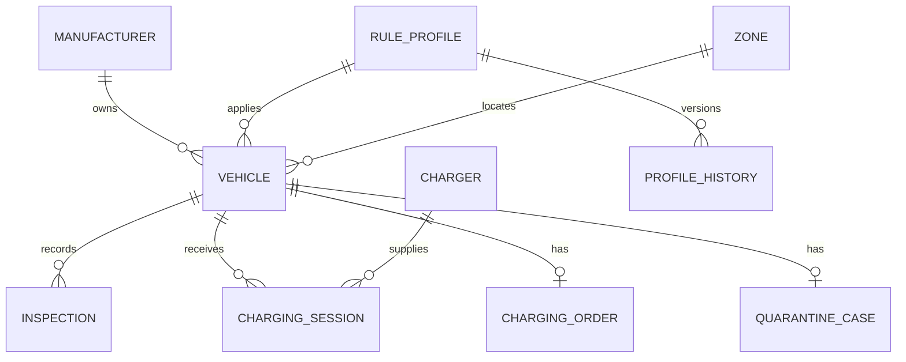

# Data model

The current store serialises the following application model in one JSON document. Property names use camelCase in JSON. This is the implemented model; a relational migration is future work.

## Core entities

| Entity | Fields and invariants |
|---|---|
| Vehicle | Unique validated VIN, fab/manufacturer code, brand/model/powertrain, nominal kWh, zone, profile, arrival, optional departure/destination, departed flag, latest SOC/12V, manual inspection date |
| Inspection | Date, observed SOC, 12V state, damage/concern flags, note, source, profile ID/version, actor, optional exact recordedAt for new entries |
| RuleProfile | Applicability, ordered thresholds, intervals, discharge fallback, departure ranges, version and effective date |
| Zone | Code, type, physical capacity, maximum EV count and derived occupancy |
| Charger | Code, fixed/mobile type, power, zone, state and optional occupiedBy VIN |
| ChargingOrder | VIN-keyed approved/running state, assigned charger, start SOC and start time |
| ChargingSession | VIN, manufacturer, charger, start/end, start/end SOC, kWh and estimatedKwh flag |
| QuarantineCase | Reason, opened date, decision, justification and deciding actor |
| AuditEntry | Unique ID, UTC timestamp, server actor, command name, subject and transaction detail |

## Aggregates and provenance

Vehicle inspection history is append-only through application commands. New manual inspections capture the active profile version; profile edits move the old object into profileHistory. Charging creates a separate energy session plus an SOC observation, without resetting manual inspection freshness.

The single quarantineCase property describes the latest case. Earlier reopen/decision payloads are not fully retained as a separate case history. Audit entries record command metadata, not a complete before/after snapshot; this is a known evidence limitation for the next database model.

## Missing data

New imports have no inspection history and show Not measured. The internal zero SOC and deliberately stale inspection date are conservative placeholders, not actual observations. Current evaluation emits INSPECTION_REQUIRED instead of interpreting these defaults as a measured flat battery. The interface and emergency export display unknown/unmeasured values. Require an arrival inspection before operational decisions that depend on SOC. The schema should move these fields to nullable observations during the relational migration.

## Persistence invariants

- Commands require the current global revision.
- One process owns the file; a process-local lock serialises changes.
- Copy-on-write enables rollback on validation or save failure.
- Atomic replacement prevents partially written committed JSON.
- Derived zone counts exclude departed vehicles.
- No deletion/edit endpoints exist for inspections or audit entries.

A local administrator can still edit the file directly. Append-only API behaviour is not tamper-proof storage.

## Relational migration design

Introduce TerminalId on every aggregate, unique (TerminalId,VIN), unique active order/charger allocation, append-only inspection IDs, normalised profile versions and quarantine cases, and immutable report snapshots. Use foreign keys, check constraints for numeric ranges, transactional revision columns and indexes on tenant, VIN, zone, departure and inspection due date. Prove tenant isolation and rollback with database-backed integration tests before switching adapters.
