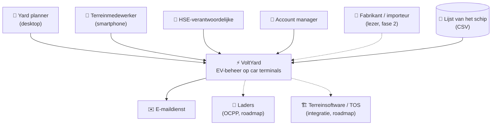
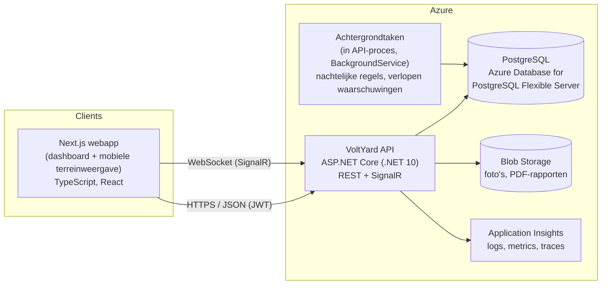
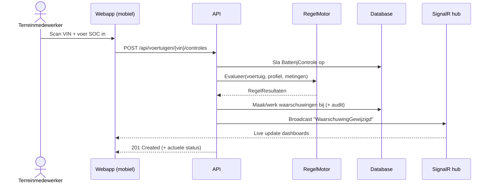
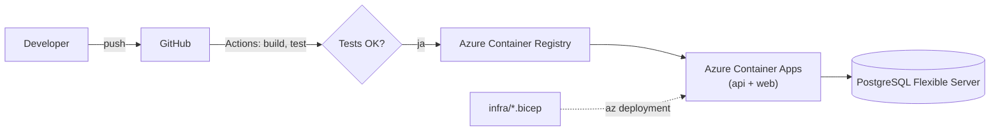

# Architectuur

*Opgebouwd volgens het [C4-model](https://c4model.com/): Context → Containers → Componenten. Beslissingen staan in de [ADR's](adr/README.md).*

## 1. Systeemcontext (C4 niveau 1)



## 2. Containers (C4 niveau 2)



| Container | Technologie | Verantwoordelijkheid |
|---|---|---|
| **Webapp** | Next.js (App Router), TypeScript, Tailwind, shadcn/ui, Recharts, ZXing (barcode) | UI voor alle rollen; mobiele weergave voor controles |
| **API** | ASP.NET Core Web API, .NET 10 | Businesslogica, regelmotor, authenticatie, REST-endpoints, SignalR-hub |
| **Achtergrondtaken** | `BackgroundService` + `PeriodicTimer` (V1) | Nachtelijke regelbeoordeling, waarschuwingen laten escaleren |
| **Database** | PostgreSQL 16+, EF Core | Alle data, auditlog |
| **Blob Storage** | Azure Blob Storage (lokaal: Azurite) | Foto's van schade, gegenereerde PDF's |
| **Monitoring** | OpenTelemetry → Application Insights | Observability |

## 3. Componenten in de API (C4 niveau 3)

**Modulaire monoliet** (zie [ADR-0004](adr/0004-modulaire-monoliet.md)): één deploybare API, intern opgedeeld per module.

```
src/
├── VoltYard.Api/                  # ASP.NET Core host: controllers, SignalR-hub, auth, DI
├── VoltYard.Domain/               # Entiteiten, value objects, regelmotor (GEEN afhankelijkheden)
│   ├── Voertuigen/
│   ├── Controles/
│   ├── Regels/                    # Regelprofiel, RegelMotor, IRegel-implementaties, Voorspeller
│   ├── Waarschuwingen/
│   ├── Terrein/                   # Zones, quarantaine
│   └── Laden/                     # Lader, Laadopdracht, Laadsessie, LaadPlanner
├── VoltYard.Application/          # Use cases / services, DTO's, validatie (FluentValidation)
├── VoltYard.Infrastructure/       # EF Core DbContext, migraties, repositories, PDF, blob, e-mail
tests/
├── VoltYard.Domain.Tests/         # Unit tests (xUnit): regelmotor, voorspelling, statusmachine, VIN-validatie
├── VoltYard.Api.IntegrationTests/ # WebApplicationFactory + Testcontainers (PostgreSQL)
web/                               # Next.js frontend
infra/                             # Bicep-templates
.github/workflows/                 # CI/CD
```

### Belangrijkste componenten

| Component | Verantwoordelijkheid |
|---|---|
| `RegelProfielKiezer` | Kiest het meest specifieke profiel voor een voertuig |
| `RegelMotor` | Voert alle `IRegel`-implementaties uit op een voertuig en geeft een lijst van `RegelResultaat` terug |
| `IRegel` (bv. `SocOnderMinimumRegel`) | Eén regel = één klasse = één unit test-suite |
| `SocVoorspeller` | Berekent de ontlaadsnelheid en de voorspelde laadtoestand |
| `WaarschuwingService` | Maakt waarschuwingen aan, werkt ze bij of sluit ze (geen duplicaten) |
| `VoertuigStatusMachine` | Bewaakt de toegelaten statusovergangen |
| `LaadOpdrachtGenerator` | Zet waarschuwingen om in voorgestelde laadopdrachten met doellaadtoestand en prioriteit |
| `LaadPlanner` *(Could)* | Greedy planning met capaciteit en maximaal vermogen |
| `RapportGenerator` | PDF-overdrachtsrapporten |
| `NachtelijkeRegelJob` | Achtergrondtaak die alle actieve voertuigen beoordeelt |
| `VoltYardHub` (SignalR) | Stuurt live waarschuwingen en statuswijzigingen naar de clients |

## 4. Belangrijkste flow: controle registreren



## 5. Kwaliteitseisen

| Kenmerk | Eis (V1) | Hoe |
|---|---|---|
| **Performantie** | Controle registreren < 500 ms (p95); dashboard < 1 s bij 10.000 voertuigen | Indexen op VIN, status en zone; paginering; projecties |
| **Schaal** | 50.000 actieve voertuigen per terminal | Nachtelijke taak in batches |
| **Beschikbaarheid** | 99,5% (buiten onderhoud) | Container Apps met minstens één replica |
| **Beveiliging** | OWASP Top 10, rollen, tenant-isolatie | Zie [security](security-en-privacy.md) |
| **Traceerbaarheid** | Elke wijziging staat in de audit; metingen zijn *append-only* | Auditlog-tabel, metingen nooit updaten of verwijderen |
| **Bruikbaarheid op het terrein** | Controle in < 30 sec, knoppen ≥ 48 px | Mobiele weergave, scan in plaats van typen |
| **Testbaarheid** | Regelmotor ≥ 90% dekking | Domein zonder afhankelijkheden |

## 6. Deployment



- **Lokaal:** `docker compose up` → API, webapp, PostgreSQL en Azurite (blob).
- **CI:** bij elke PR worden de build, de unit tests en de integratietests (Testcontainers) uitgevoerd, plus lint en typecheck van de frontend.
- **CD:** een merge naar `main` bouwt de images, zet ze in ACR en deployt naar Container Apps.
- **Infrastructuur:** volledig in Bicep (`infra/`), zie [ADR-0006](adr/0006-azure-bicep.md).
- **Kosten (schatting):** zie [ADR-0006](adr/0006-azure-bicep.md).
