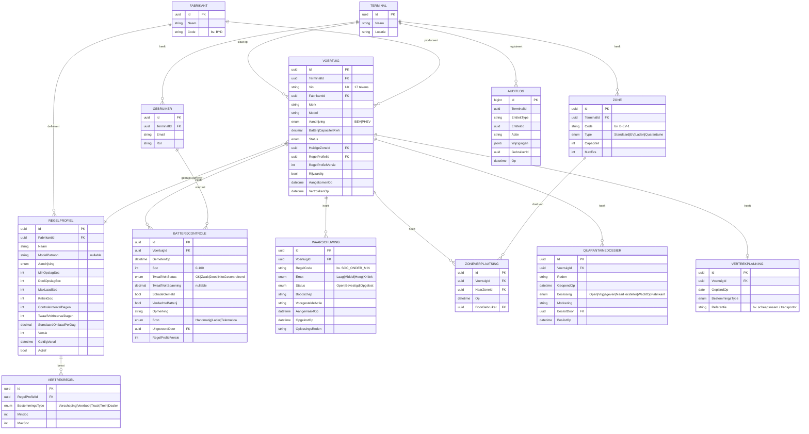

# Datamodel

## ERD (kern)

De entiteiten van de laadmodule (Lader, Laadopdracht, Laadsessie) staan in [laadmodule.md](../03-concept/laadmodule.md).

## Ontwerpkeuzes

| Keuze | Reden |
|---|---|
| **Metingen zijn append-only** | Bewijswaarde: een controle wordt nooit aangepast. Een correctie is een nieuwe controle met een opmerking |
| **Controle bewaart `RegelProfielVersie`** | Achteraf aantonen welke regels op dat moment golden |
| **Zoneverplaatsingen als historiek** | Waar stond de wagen wanneer? Nodig voor het overdrachtsrapport en incidentonderzoek |
| **`TerminalId` op elke tenant-tabel** | Multi-tenant met een *global query filter* in EF Core |
| **Waarschuwing met `RegelCode`** | Er is maar één open waarschuwing per voertuig en regelcode. Ze wordt bijgewerkt in plaats van gedupliceerd |
| **SOC als integer 0–100** | Het display van de wagen toont hele procenten. Genoeg precisie |
| **`jsonb` voor de audit** | Flexibel. PostgreSQL kan erin zoeken |

## Indexen (eerste inschatting)

- `Voertuig (TerminalId, Vin)` UNIQUE
- `Voertuig (TerminalId, Status)`, `Voertuig (HuidigeZoneId)`
- `BatterijControle (VoertuigId, GemetenOp DESC)`
- `Waarschuwing (VoertuigId, RegelCode) WHERE Status <> 'Opgelost'` UNIQUE (partiële index)
- `Waarschuwing (TerminalId, Status, Ernst)`

## Seed-data voor demo en tests

- 1 terminal "Demo Terminal Zeebrugge", zones A–F (waaronder 1 quarantainezone en 1 laadzone)
- 4 fictieve fabrikanten met elk 1–2 regelprofielen
- ~2.000 voertuigen met een realistische geschiedenis (gegenereerd met **Bogus**), waarvan een deel met problemen, zodat het dashboard er echt uitziet
- Gebruikers voor elke rol
