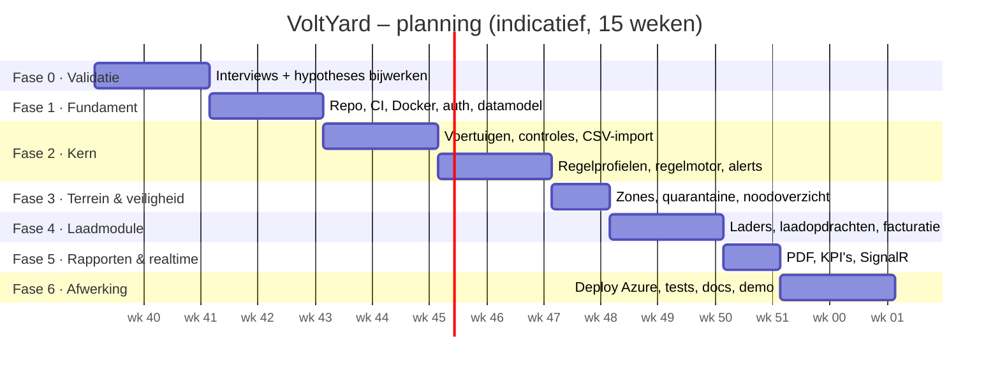

# Plan van aanpak

## 1. Aanleiding
Finalisatieproject van de opleiding Full Stack Developer (keuze: C#). Het project moet een volledige full-stack applicatie opleveren, en wordt zo opgezet dat het ook als portfolio en mogelijk later als product kan dienen. Zie de [probleemstelling](../01-probleem/probleemstelling.md).

## 2. Doelstelling
> Binnen de beschikbare periode een werkende, online gedeployde webapplicatie opleveren waarmee een car terminal per EV de batterijtoestand kan opvolgen, de regels van de fabrikant automatisch kan toepassen, risico's (quarantaine, zones) kan beheren en een overdrachtsrapport kan genereren, **met** een laadmodule als uitbreiding.

**SMART-criteria**
- **Specifiek:** alle *Must*-features uit [features.md](../03-concept/features.md), plus zoveel mogelijk *Should*.
- **Meetbaar:** alle acceptatiecriteria in de [backlog](backlog.md) gehaald, ≥ 80% testdekking op `Domain`, een CI-pipeline die slaagt.
- **Acceptabel:** de scope past bij de eisen van de opleiding (te bevestigen).
- **Realistisch:** de minimale versie in ongeveer 60% van de tijd, de rest voor uitbreidingen en afwerking.
- **Tijdgebonden:** zie de planning hieronder (aan te passen aan de werkelijke deadline).

## 3. Scope

**Binnen de scope:** zie [features.md](../03-concept/features.md): alles met M en S.
**Buiten de scope:** OCPP-koppeling, telematica, publieke API, native mobiele app, SSO, offline werken (tenzij er tijd over is).

## 4. Aanpak en methode
- **Scrum-light:** sprints van 2 weken, met aan het begin van elke sprint een sprintdoel en backlog-items.
- **Tooling:** GitHub Projects (bord: Backlog → Ready → In Progress → Review → Done), issues per user story, PR per feature (ook alleen: om zelf te reviewen en CI te laten lopen).
- **Branching:** `main` is altijd deploybaar; feature branches `feat/...`, `fix/...`; squash merge.
- **Commits:** Conventional Commits (`feat:`, `fix:`, `docs:`, `test:`...).
- **Documentatie:** ADR bij elke belangrijke beslissing; README en docs actueel houden.
- **Wekelijks logboek:** kort bijhouden in `docs/logboek.md` (handig voor het verslag en de verdediging).

## 5. Fasering en planning

*De planning gaat uit van **15 weken**. Ligt de deadline anders, dan schalen we de fasen proportioneel mee en schrappen we eerst Could, dan Should.*

| Fase | Weken | Doel | Oplevering (Definition of Done per fase) |
|---|---|---|---|
| **0. Validatie** | 1–2 | Het probleem toetsen, de scope vastleggen | ≥ 3 gesprekken uitgewerkt, [hypotheses](../04-validatie/hypotheses.md) bijgewerkt, eisen van de opleiding gecontroleerd, ADR-0003 definitief |
| **1. Fundament** | 3–4 | Een skelet dat van begin tot eind werkt | Solution-structuur, Docker Compose, EF Core + eerste migratie, Identity + JWT + rollen, Next.js met login, CI groen, seed-data |
| **2a. Voertuigen en controles** | 5–6 | De basis van de werking | CRUD voor voertuigen, VIN-validatie, CSV-import, mobiel controleformulier, tijdlijn |
| **2b. Regels en waarschuwingen** | 7–8 | **Het hart van het systeem** | Regelprofielen (CRUD + versies), profielkiezer, regelmotor met alle V1-regels + unit tests, nachtelijke taak, waarschuwingen + dashboard |
| **3. Terrein en veiligheid** | 9 | Veiligheid | Zones, verplaatsingen, quarantaineworkflow, dichtheidsregels, noodoverzicht |
| **4. Laadmodule** | 10–11 | De uitbreiding | Laders, laadopdrachten (automatisch + handmatig), sessies, kWh, facturatie-CSV |
| **5. Rapporten en realtime** | 12 | Bewijs en afwerking | Overdrachtsrapport (PDF), KPI's, SignalR live updates, VIN-scan |
| **6. Afwerking** | 13–15 | Opleveren | Bicep + deployment naar Azure, integratietests, performantietest (10.000 voertuigen), README, [demoscript](../07-finalisatie/demoscript.md), verslag, presentatie |

**Buffer:** fase 6 bevat bewust een marge. Loopt er iets uit, dan schuiven we Could-items weg, niet de afwerking.

## 6. Mijlpalen

| # | Mijlpaal | Wanneer | Criterium |
|---|---|---|---|
| M1 | Go / no-go voor het idee | Einde week 2 | Hypotheses P1–P3 niet weerlegd *(of een bewuste keuze om toch door te gaan voor de finalisatie)* |
| M2 | "Walking skeleton" | Einde week 4 | Inloggen → voertuig aanmaken → zien in de lijst, gedeployd via CI |
| M3 | **Minimale versie klaar** | Einde week 9 | Alle Must-features werken lokaal |
| M4 | Doel klaar | Einde week 12 | Alle Should-features |
| M5 | Oplevering | Einde week 15 | Online, getest, gedocumenteerd, demo geoefend |

## 7. Kwaliteit
- Zie de [Definition of Done](definition-of-done.md).
- **Tests:** unit tests (Domain), integratietests (API + echte PostgreSQL via Testcontainers), een handvol end-to-end tests (Playwright) voor de kernflows.
- **Codekwaliteit:** `dotnet format`, nullable ingeschakeld, *warnings as errors*; ESLint + Prettier + `tsc --noEmit` voor de frontend.
- **Review:** elke PR zelf reviewen met de checklist; af en toe feedback vragen aan een docent of medestudent.

## 8. Risico's
Zie [risicos.md](risicos.md).

## 9. Oplevering (einde van het project)
1. Broncode in GitHub (privé, toegang voor de jury indien nodig)
2. Een online demo-omgeving (Azure) met seed-data
3. Documentatie (deze repo): concept, architectuur, ADR's, API-documentatie (OpenAPI)
4. Testrapport (dekking + overzicht)
5. Verslag / portfolio volgens het sjabloon van de opleiding
6. Presentatie + live demo ([demoscript](../07-finalisatie/demoscript.md))
