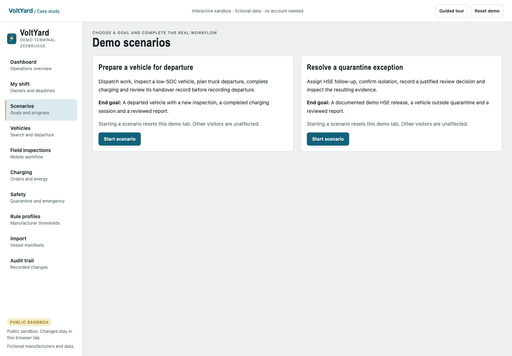

# Goal-based demo scenarios and shift work

## Try a scenario

Open the public demo, choose **Scenarios**, then start departure preparation or quarantine exception review. Confirm the fresh-yard reset. It affects only your browser tab. Starting another scenario discards that tab's previous observations and assignments; ending a scenario keeps the work you recorded. Refresh preserves active progress. New vehicle evidence or profile changes invalidate an earlier report-review step; confirmation of departure preserves the pre-departure review. Reset demo clears it.

A progress panel states the goal, next step and evidence checklist. Use Continue next step or navigate freely. Completed evidence must exist in the yard state; there are no completion checkboxes.

Departure: assign follow-up, record SOC 18% and auxiliary battery OK, plan Truck departure for the displayed scenario date, approve/start/stop charging at the displayed target, review the report and confirm departure. Quarantine: assign HSE review, isolate if needed, enter a justified fictional Released decision and review the report. Review flags demonstrate visitor progress; they are not signed report approvals. The fixed dataset and manufacturer values are fictional, and the scenario date is deliberately not the visitor's real date.

The backend Scenarios screen links to the isolated public edition. It cannot reset persistent server records.

## Dispatch and personal views

Open **My shift**. Empty personal views link to Unassigned; use All open work to inspect the full backlog. Search VIN/model and page through twenty tasks at a time. Admin/Planner can assign/reschedule or return an assignment to the backlog. Public visitors simulate the dispatcher. The public My demo account selector only changes the personal filter and is saved in the tab; it grants no real permissions. The backend uses the signed-in identity.

Eligible owners: admin for every kind and exclusively for rule-conflict review; hse for quarantine review; operator for inspections; operator/planner for charging coordination; planner for handover. Account is read-only. Starting/stopping equipment workflows, approving charge and releasing quarantine continue to use their existing server permissions.

Deadlines are entered and displayed in UTC. They may be up to 365 days before/after the current shift snapshot; intentionally past deadlines show Overdue. The public shift is fixed at 12:00 UTC on the displayed scenario date. The backend uses its actual evaluation timestamp; Refresh shift reloads data and overdue status. There is no background notification scheduler.

## Priority and completion

Safety base 400; critical SOC, missing inspection or recorded immobility or conflicting target 300; other observation/charging follow-up 200; planned handover 100. An overdue assigned deadline adds 50; planned departure today/tomorrow or earlier adds 25. Sort by descending score, then earlier assigned deadline, then stable task ID. Scores explain work ordering and do not measure battery risk. A predicted low SOC when the charge target is already reached creates observation review work instead of an impossible charging instruction.

Work is derived from the current recorded conditions. An assigned task becomes completed when its trigger disappears; a later trigger reopens the same VIN/kind assignment, retaining its owner/deadline. Unassigned resolved tasks disappear. This does not prove that a particular person performed physical work. The card explains the state and shows recent assignment changes; all assignment changes remain in the store and survive backend restarts. Reports and quarantine safety authority retain their documented limitations.

No individual production identity, shift roster/capacity optimiser, recurring yard-visit model, outbound reminders or operational approval is delivered by this feature.
